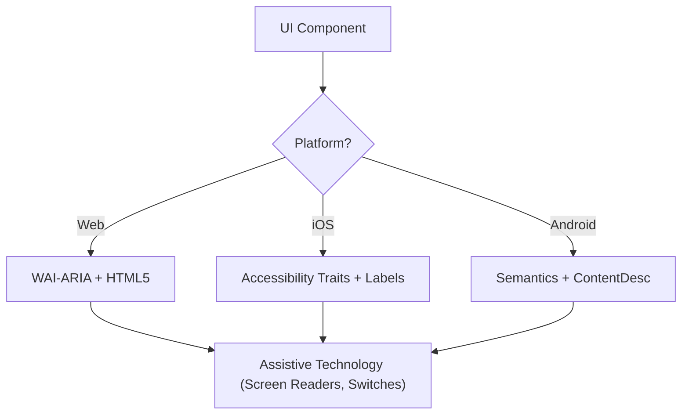

# Accessibility (WCAG 2.2)

Skill này đảm bảo giao diện số Perceivable, Operable, Understandable và Robust (POUR) với mọi người dùng, kể cả những người dùng screen reader, switch control hoặc điều hướng bằng bàn phím. Skill tập trung vào việc triển khai kỹ thuật các success criterion của WCAG 2.2.

## Khi nào dùng

- Định nghĩa đặc tả component UI cho Web, iOS hoặc Android.
- Audit code hiện có để tìm rào cản accessibility hoặc lỗ hổng tuân thủ.
- Triển khai các tiêu chuẩn mới của WCAG 2.2 như Target Size (Minimum) và Focus Appearance.
- Ánh xạ yêu cầu thiết kế cấp cao sang các thuộc tính kỹ thuật (ARIA role, trait, hint).

## Khái niệm cốt lõi

- **Nguyên tắc POUR**: Nền tảng của WCAG (Perceivable, Operable, Understandable, Robust).
- **Semantic Mapping**: Dùng phần tử native thay vì container chung chung để có sẵn accessibility.
- **Accessibility Tree**: Biểu diễn của UI mà công nghệ hỗ trợ (assistive technology) thực sự "đọc".
- **Focus Management**: Kiểm soát thứ tự và khả năng hiển thị của con trỏ bàn phím/screen reader.
- **Labeling & Hints**: Cung cấp ngữ cảnh qua `aria-label`, `accessibilityLabel` và `contentDescription`.

## Cách hoạt động

### Bước 1: Xác định vai trò của Component

Xác định mục đích chức năng (ví dụ: đây là button, link hay tab?). Dùng phần tử native có ngữ nghĩa nhất sẵn có trước khi chuyển sang role tùy chỉnh.

### Bước 2: Định nghĩa các thuộc tính Perceivable

- Đảm bảo độ tương phản văn bản đạt **4.5:1** (thường) hoặc **3:1** (lớn/UI).
- Thêm text alternative cho nội dung không phải văn bản (ảnh, icon).
- Triển khai responsive reflow (zoom tới 400% mà không mất chức năng).

### Bước 3: Triển khai các điều khiển Operable

- Đảm bảo kích thước vùng chạm tối thiểu **24x24 CSS pixel** (WCAG 2.2 SC 2.5.8).
- Xác minh mọi phần tử tương tác đều truy cập được bằng bàn phím và có chỉ báo focus hiển thị rõ (SC 2.4.11).
- Cung cấp phương án thay thế bằng một con trỏ (single-pointer) cho các thao tác kéo.

### Bước 4: Đảm bảo logic Understandable

- Dùng các pattern điều hướng nhất quán.
- Cung cấp thông báo lỗi mô tả rõ và gợi ý cách sửa (SC 3.3.3).
- Triển khai "Redundant Entry" (SC 3.3.7) để tránh yêu cầu nhập cùng một dữ liệu hai lần.

### Bước 5: Xác minh tính tương thích Robust

- Dùng đúng các pattern `Name, Role, Value`.
- Triển khai `aria-live` hoặc live region cho các cập nhật trạng thái động.

## Sơ đồ kiến trúc Accessibility



## Ánh xạ đa nền tảng

| Tính năng            | Web (HTML/ARIA)          | iOS (SwiftUI)                        | Android (Compose)                                           |
| :----------------- | :----------------------- | :----------------------------------- | :---------------------------------------------------------- |
| **Label chính**  | `aria-label` / `<label>` | `.accessibilityLabel()`              | `contentDescription`                                        |
| **Hint phụ** | `aria-describedby`       | `.accessibilityHint()`               | `Modifier.semantics { stateDescription = ... }`             |
| **Action Role**    | `role="button"`          | `.accessibilityAddTraits(.isButton)` | `Modifier.semantics { role = Role.Button }`                 |
| **Cập nhật trực tiếp (Live Updates)**   | `aria-live="polite"`     | `.accessibilityLiveRegion(.polite)`  | `Modifier.semantics { liveRegion = LiveRegionMode.Polite }` |

## Ví dụ

### Web: Ô tìm kiếm accessible

```html
<form role="search">
  <label for="search-input" class="sr-only">Search products</label>
  <input type="search" id="search-input" placeholder="Search..." />
  <button type="submit" aria-label="Submit Search">
    <svg aria-hidden="true">...</svg>
  </button>
</form>
```

### iOS: Nút hành động accessible

```swift
Button(action: deleteItem) {
    Image(systemName: "trash")
}
.accessibilityLabel("Delete item")
.accessibilityHint("Permanently removes this item from your list")
.accessibilityAddTraits(.isButton)
```

### Android: Toggle accessible

```kotlin
Switch(
    checked = isEnabled,
    onCheckedChange = { onToggle() },
    modifier = Modifier.semantics {
        contentDescription = "Enable notifications"
    }
)
```

## Anti-Pattern cần tránh

- **Div-Buttons**: Dùng `<div>` hoặc `<span>` cho sự kiện click mà không thêm role và hỗ trợ bàn phím.
- **Color-Only Meaning**: Chỉ biểu thị lỗi hoặc trạng thái _bằng_ thay đổi màu (ví dụ: đổi viền sang màu đỏ).
- **Uncontained Modal Focus**: Modal không giữ (trap) focus, cho phép người dùng bàn phím điều hướng nội dung nền khi modal đang mở. Focus phải được giữ trong modal _và_ thoát được bằng phím `Escape` hoặc nút đóng tường minh (WCAG SC 2.1.2).
- **Redundant Alt Text**: Dùng "Image of..." hoặc "Picture of..." trong alt text (screen reader đã đọc role "Image" rồi).

## Checklist thực hành tốt

- [ ] Các phần tử tương tác đạt kích thước vùng chạm **24x24px** (Web) hoặc **44x44pt** (Native).
- [ ] Chỉ báo focus hiển thị rõ ràng và có độ tương phản cao.
- [ ] Modal **giữ focus** khi đang mở, và nhả focus gọn gàng khi đóng (phím `Escape` hoặc nút đóng).
- [ ] Dropdown và menu khôi phục focus về phần tử kích hoạt khi đóng.
- [ ] Form cung cấp gợi ý lỗi dạng văn bản.
- [ ] Mọi nút chỉ có icon đều có label văn bản mô tả.
- [ ] Nội dung reflow đúng khi văn bản được phóng to.

## Tham khảo

- [WCAG 2.2 Guidelines](https://www.w3.org/TR/WCAG22/)
- [WAI-ARIA Authoring Practices](https://www.w3.org/TR/wai-aria-practices/)
- [iOS Accessibility Programming Guide](https://developer.apple.com/documentation/accessibility)
- [iOS Human Interface Guidelines - Accessibility](https://developer.apple.com/design/human-interface-guidelines/accessibility)
- [Android Accessibility Developer Guide](https://developer.android.com/guide/topics/ui/accessibility)

## Skill liên quan

- `frontend-patterns`
- `design-system`
- `liquid-glass-design`
- `swiftui-patterns`
