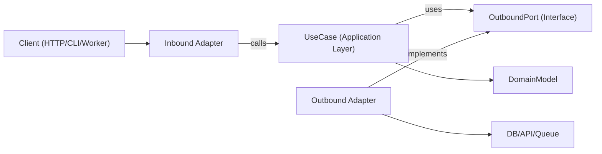

# Hexagonal Architecture

Hexagonal architecture (Ports and Adapters) giữ cho business logic độc lập với framework, transport và chi tiết persistence. Phần lõi của ứng dụng phụ thuộc vào các port trừu tượng, còn các adapter triển khai những port đó ở rìa hệ thống.

## Khi nào dùng

- Xây dựng tính năng mới mà khả năng bảo trì và khả năng kiểm thử dài hạn là quan trọng.
- Refactor code phân tầng hoặc nặng framework, nơi logic domain bị trộn lẫn với các mối quan tâm về I/O.
- Hỗ trợ nhiều giao diện cho cùng một use case (HTTP, CLI, queue worker, cron job).
- Thay thế hạ tầng (database, API bên ngoài, message bus) mà không phải viết lại business rule.

Dùng skill này khi yêu cầu liên quan đến ranh giới, thiết kế lấy domain làm trung tâm, refactor các service gắn kết chặt, hoặc tách logic ứng dụng khỏi các thư viện cụ thể.

## Khái niệm cốt lõi

- **Domain model**: Business rule và entity/value object. Không import framework.
- **Use case (tầng application)**: Điều phối hành vi domain và các bước workflow.
- **Inbound port**: Contract mô tả ứng dụng có thể làm gì (command/query/interface của use case).
- **Outbound port**: Contract cho các dependency mà ứng dụng cần (repository, gateway, event publisher, clock, UUID, v.v.).
- **Adapter**: Phần triển khai hạ tầng và delivery của các port (HTTP controller, DB repository, queue consumer, SDK wrapper).
- **Composition root**: Vị trí wiring duy nhất, nơi các adapter cụ thể được gắn vào use case.

Interface của outbound port thường nằm ở tầng application (hoặc ở domain chỉ khi abstraction thực sự thuộc mức domain), còn các adapter hạ tầng triển khai chúng.

Hướng phụ thuộc luôn hướng vào trong:

- Adapter -> application/domain
- Application -> các port interface (contract inbound/outbound)
- Domain -> các abstraction chỉ thuộc domain (không phụ thuộc framework hay hạ tầng)
- Domain -> không phụ thuộc gì bên ngoài

## Cách hoạt động

### Bước 1: Mô hình hóa ranh giới của một use case

Định nghĩa một use case duy nhất với DTO đầu vào và đầu ra rõ ràng. Giữ các chi tiết transport (Express `req`, GraphQL `context`, wrapper payload của job) bên ngoài ranh giới này.

### Bước 2: Định nghĩa outbound port trước

Xác định mọi side effect như một port:

- persistence (`UserRepositoryPort`)
- lời gọi bên ngoài (`BillingGatewayPort`)
- cross-cutting (`LoggerPort`, `ClockPort`)

Port nên mô hình hóa năng lực (capability), không phải công nghệ.

### Bước 3: Triển khai use case chỉ với điều phối thuần túy

Class/function của use case nhận các port qua constructor/đối số. Nó kiểm tra các invariant ở mức application, điều phối các domain rule và trả về các cấu trúc dữ liệu thuần.

### Bước 4: Xây dựng adapter ở rìa

- Inbound adapter chuyển đổi đầu vào của giao thức thành đầu vào của use case.
- Outbound adapter ánh xạ contract của ứng dụng sang các API/ORM/query builder cụ thể.
- Việc mapping nằm trong adapter, không nằm bên trong use case.

### Bước 5: Wiring mọi thứ trong composition root

Khởi tạo các adapter, rồi inject chúng vào use case. Giữ việc wiring này tập trung để tránh hành vi service-locator ẩn.

### Bước 6: Test theo từng ranh giới

- Unit test use case với các fake port.
- Integration test adapter với các dependency hạ tầng thật.
- E2E test các luồng hướng người dùng thông qua inbound adapter.

## Sơ đồ kiến trúc



## Bố cục module đề xuất

Dùng tổ chức theo feature-first với các ranh giới tường minh:

```text
src/
  features/
    orders/
      domain/
        Order.ts
        OrderPolicy.ts
      application/
        ports/
          inbound/
            CreateOrder.ts
          outbound/
            OrderRepositoryPort.ts
            PaymentGatewayPort.ts
        use-cases/
          CreateOrderUseCase.ts
      adapters/
        inbound/
          http/
            createOrderRoute.ts
        outbound/
          postgres/
            PostgresOrderRepository.ts
          stripe/
            StripePaymentGateway.ts
      composition/
        ordersContainer.ts
```

## Ví dụ TypeScript

### Định nghĩa port

```typescript
export interface OrderRepositoryPort {
  save(order: Order): Promise<void>;
  findById(orderId: string): Promise<Order | null>;
}

export interface PaymentGatewayPort {
  authorize(input: { orderId: string; amountCents: number }): Promise<{ authorizationId: string }>;
}
```

### Use case

```typescript
type CreateOrderInput = {
  orderId: string;
  amountCents: number;
};

type CreateOrderOutput = {
  orderId: string;
  authorizationId: string;
};

export class CreateOrderUseCase {
  constructor(
    private readonly orderRepository: OrderRepositoryPort,
    private readonly paymentGateway: PaymentGatewayPort
  ) {}

  async execute(input: CreateOrderInput): Promise<CreateOrderOutput> {
    const order = Order.create({ id: input.orderId, amountCents: input.amountCents });

    const auth = await this.paymentGateway.authorize({
      orderId: order.id,
      amountCents: order.amountCents,
    });

    // markAuthorized returns a new Order instance; it does not mutate in place.
    const authorizedOrder = order.markAuthorized(auth.authorizationId);
    await this.orderRepository.save(authorizedOrder);

    return {
      orderId: order.id,
      authorizationId: auth.authorizationId,
    };
  }
}
```

### Outbound adapter

```typescript
export class PostgresOrderRepository implements OrderRepositoryPort {
  constructor(private readonly db: SqlClient) {}

  async save(order: Order): Promise<void> {
    await this.db.query(
      "insert into orders (id, amount_cents, status, authorization_id) values ($1, $2, $3, $4)",
      [order.id, order.amountCents, order.status, order.authorizationId]
    );
  }

  async findById(orderId: string): Promise<Order | null> {
    const row = await this.db.oneOrNone("select * from orders where id = $1", [orderId]);
    return row ? Order.rehydrate(row) : null;
  }
}
```

### Composition root

```typescript
export const buildCreateOrderUseCase = (deps: { db: SqlClient; stripe: StripeClient }) => {
  const orderRepository = new PostgresOrderRepository(deps.db);
  const paymentGateway = new StripePaymentGateway(deps.stripe);

  return new CreateOrderUseCase(orderRepository, paymentGateway);
};
```

## Ánh xạ đa ngôn ngữ

Dùng cùng các quy tắc ranh giới cho mọi hệ sinh thái; chỉ có cú pháp và phong cách wiring thay đổi.

- **TypeScript/JavaScript**
  - Port: `application/ports/*` dưới dạng interface/type.
  - Use case: class/function với injection qua constructor/đối số.
  - Adapter: `adapters/inbound/*`, `adapters/outbound/*`.
  - Composition: module factory/container tường minh (không có global ẩn).
- **Java**
  - Package: `domain`, `application.port.in`, `application.port.out`, `application.usecase`, `adapter.in`, `adapter.out`.
  - Port: interface trong `application.port.*`.
  - Use case: class thuần (Spring `@Service` là tùy chọn, không bắt buộc).
  - Composition: Spring config hoặc class wiring thủ công; giữ wiring ngoài các class domain/use case.
- **Kotlin**
  - Module/package phản chiếu cách chia của Java (`domain`, `application.port`, `application.usecase`, `adapter`).
  - Port: interface Kotlin.
  - Use case: class với constructor injection (Koin/Dagger/Spring/thủ công).
  - Composition: định nghĩa module hoặc các hàm composition chuyên dụng; tránh các pattern service locator.
- **Go**
  - Package: `internal/<feature>/domain`, `application`, `ports`, `adapters/inbound`, `adapters/outbound`.
  - Port: interface nhỏ do package application tiêu thụ sở hữu.
  - Use case: struct với các field interface cùng các constructor `New...` tường minh.
  - Composition: wiring trong `cmd/<app>/main.go` (hoặc package wiring chuyên dụng), giữ constructor tường minh.

## Anti-Pattern cần tránh

- Domain entity import ORM model, kiểu của web framework hoặc SDK client.
- Use case đọc trực tiếp từ `req`, `res` hoặc metadata của queue.
- Trả về trực tiếp các dòng database từ use case mà không mapping domain/application.
- Để các adapter gọi trực tiếp lẫn nhau thay vì đi qua các port của use case.
- Rải wiring dependency ra nhiều file với các global singleton ẩn.

## Playbook di chuyển (Migration)

1. Chọn một vertical slice (một endpoint/job) có nhiều đau đớn khi thay đổi thường xuyên.
2. Tách một ranh giới use case với các kiểu input/output tường minh.
3. Đưa vào các outbound port bao quanh các lời gọi hạ tầng hiện có.
4. Chuyển logic điều phối từ controller/service vào use case.
5. Giữ các adapter cũ, nhưng cho chúng ủy quyền (delegate) sang use case mới.
6. Thêm test quanh ranh giới mới (unit + adapter integration).
7. Lặp lại từng slice một; tránh viết lại toàn bộ.

### Refactor các hệ thống hiện có

- **Cách tiếp cận Strangler**: giữ các endpoint hiện tại, định tuyến từng use case một qua các port/adapter mới.
- **Không viết lại kiểu big-bang**: di chuyển theo từng feature slice và bảo toàn hành vi bằng characterization test.
- **Facade trước**: bọc các service legacy sau các outbound port trước khi thay thế phần bên trong.
- **Đóng băng composition**: tập trung wiring sớm để các dependency mới không rò rỉ vào tầng domain/use case.
- **Quy tắc chọn slice**: ưu tiên các luồng thay đổi nhiều, phạm vi ảnh hưởng nhỏ trước.
- **Đường rollback**: giữ một toggle hoặc route switch có thể đảo ngược cho mỗi slice đã di chuyển cho đến khi hành vi production được xác minh.

## Hướng dẫn kiểm thử (Cùng các ranh giới Hexagonal)

- **Domain test**: test entity/value object như các business rule thuần (không mock, không cần cấu hình framework).
- **Use-case unit test**: test việc điều phối với fake/stub cho các outbound port; assert kết quả nghiệp vụ và các tương tác với port.
- **Outbound adapter contract test**: định nghĩa các contract suite dùng chung ở mức port và chạy chúng với từng phần triển khai adapter.
- **Inbound adapter test**: xác minh việc mapping giao thức (payload HTTP/CLI/queue sang đầu vào use case, và mapping đầu ra/lỗi ngược lại giao thức).
- **Adapter integration test**: chạy trên hạ tầng thật (DB/API/queue) để kiểm tra serialization, hành vi schema/query, retry và timeout.
- **End-to-end test**: bao phủ các hành trình người dùng quan trọng qua inbound adapter -> use case -> outbound adapter.
- **An toàn khi refactor**: thêm characterization test trước khi tách; giữ chúng cho đến khi hành vi của ranh giới mới ổn định và tương đương.

## Checklist Best Practice

- Tầng domain và use case chỉ import các kiểu nội bộ và port.
- Mọi dependency bên ngoài đều được biểu diễn bằng một outbound port.
- Validation xảy ra tại các ranh giới (inbound adapter + invariant của use case).
- Dùng các phép biến đổi bất biến (immutable) (trả về giá trị/entity mới thay vì thay đổi state dùng chung).
- Lỗi được chuyển đổi khi vượt qua các ranh giới (lỗi hạ tầng -> lỗi application/domain).
- Composition root tường minh và dễ audit.
- Use case có thể test với các fake in-memory đơn giản cho các port.
- Refactor bắt đầu từ một vertical slice với các test bảo toàn hành vi.
- Chi tiết riêng của ngôn ngữ/framework ở lại trong adapter, không bao giờ đưa vào domain rule.
