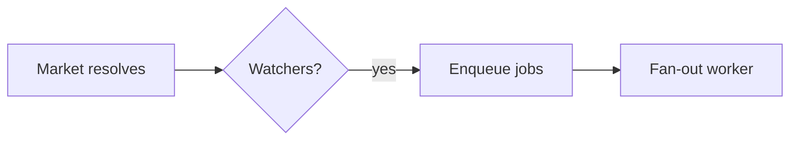

# Plan Canvas

Vòng lặp review cho plan và các artifact trực quan: bạn viết artifact, con người
review nó trong trình duyệt — chú thích đúng phần tử họ muốn nói, chat, và
đưa ra phán quyết **Approve plan / Request changes** — trong khi bạn bị chặn
(block) ở một lệnh CLI duy nhất trả về phản hồi của họ dưới dạng JSON.

Lấy cảm hứng từ [lavish-axi](https://github.com/kunchenguid/lavish-axi); được xây dựng lại
theo kiểu ECC-native quanh cổng xác nhận của `/plan`, không có dependency nào.

## Khi nào dùng

- Bạn vừa viết xong một plan artifact (`.claude/plans/*.plan.md` từ `/plan`) và
  cần quyết định CONFIRM/approve — phán quyết trên canvas thay thế việc gõ
  "yes/proceed".
- Người dùng nên *chỉ trỏ* vào thứ cần đổi: review thiết kế, so sánh,
  báo cáo, hoặc bất kỳ artifact `.md` / `.html` local nào.
- Người dùng yêu cầu `/plan-canvas`, một lần review trực quan, hoặc "mở nó trong trình duyệt".

KHÔNG dùng cho: code review diff (`/code-review`), chạy web app, hoặc
URL từ xa. Canvas chỉ phục vụ các file artifact local.

## Cách hoạt động

Gọi CLI bằng `ecc-plan-canvas` — bin được cung cấp bởi package `ecc-universal`
(nằm trên PATH sau khi cài global/plugin; `node "$CLAUDE_PLUGIN_ROOT/scripts/plan-canvas.js"`
cũng dùng được cho cài đặt plugin). Chạy nó từ dự án bạn đang review;
nó hoạt động từ bất kỳ working directory nào. Nó quản lý một server loopback tách rời (detached)
(`127.0.0.1:4517`) dùng chung cho mọi session, khóa theo đường dẫn artifact — không có
session id nào để theo dõi.

Workflow là một vòng lặp CLI-cộng-JSON đơn giản, nên độc lập với model và harness:
bất kỳ agent nào chạy được lệnh shell và đọc stdout đều điều khiển nó theo cùng một cách
(Claude Code, Codex, Cursor, Gemini, OpenCode, Copilot). Kích hoạt nó theo cách harness của bạn
hiển thị skill — ví dụ `/plan-canvas` trong Claude Code, `$plan-canvas` trong
Codex — hoặc cứ chạy trực tiếp các lệnh `ecc-plan-canvas`.

```bash
# 1. Open the artifact in the user's browser (returns immediately)
ecc-plan-canvas open .claude/plans/feature.plan.md

# 2. Block until the human responds. Leave running; re-run if interrupted:
#    queued feedback is never lost.
ecc-plan-canvas await .claude/plans/feature.plan.md
```

### Hãy tiếp tục lắng nghe, nếu không con người đang nói với chiếc ghế trống

Phản hồi chỉ đến được bạn khi có một `await` thực sự đang đậu trên session.
Nếu lượt của bạn kết thúc mà không có gì lắng nghe, tin nhắn nằm trong queue và,
từ phía bên kia tấm kính của con người, việc gửi trông như chẳng làm gì cả.

Vì vậy hãy **chạy `await` như một background task** khi harness của bạn hỗ trợ (trong
Claude Code, một lời gọi Bash với `run_in_background: true`). Nó thoát ngay khi
phản hồi đến và harness đưa JSON cho bạn, giúp giữ vòng lặp sống
xuyên suốt các lượt thay vì chết cùng lời gọi foreground. `await` ở foreground
cũng dùng được, nhưng chỉ đến khi harness giới hạn thời gian của nó.

Có hai lưới an toàn, và không cái nào là cái cớ để bỏ qua điều trên:

- `ecc-plan-canvas pending` liệt kê phản hồi đang nằm trong queue mà không có listener. Hãy kiểm tra nó
  bất cứ khi nào bạn không chắc mình có bỏ sót gì không.
- Hook `stop:plan-canvas-pending` chặn lượt của bạn kết thúc trong khi phản hồi
  từ canvas chưa được chuyển giao, và đưa các tin nhắn cho bạn. Nếu bạn đang đọc
  phản hồi từ hook đó, nghĩa là bạn đã ngừng lắng nghe quá sớm.

`await` in ra JSON khi con người thao tác:

```json
{
  "status": "feedback",
  "items": [
    { "kind": "annotation", "text": "Split this into two phases",
      "anchor": { "selector": "h2:nth-of-type(3)", "tag": "h2", "snippet": "Phase 2: Migration" } },
    { "kind": "verdict", "verdict": "request-changes" }
  ]
}
```

- `kind: "chat"` — tin nhắn tự do; hãy trả lời trong canvas, không phải trong terminal.
- `kind: "annotation"` — phản hồi neo vào một phần tử (`anchor.selector`,
  `anchor.snippet` cho thấy họ đã chỉ vào đâu; `anchor.textRange.text` khi
  họ highlight một đoạn).
- `kind: "verdict"` — `approve` nghĩa là plan đã được CONFIRMED: ngừng polling,
  kết thúc session và bắt đầu triển khai. `request-changes` nghĩa là hãy sửa
  artifact (canvas tự động reload) và giữ vòng lặp tiếp tục.

**3. Luôn phản hồi trong canvas**, rồi tiếp tục lắng nghe. Một lệnh làm cả hai:

```bash
ecc-plan-canvas await <file> --reply "Split Phase 2 as requested. Take a look."
```

Mọi tin nhắn của con người đều được trả lời trong canvas, kể cả một câu ngắn như
"On it, rewriting the risk table now." Sự im lặng trong khung chat không thể
phân biệt với một canvas bị hỏng, và đó chính là lỗi mà vòng lặp này
sinh ra để ngăn chặn. Hãy trả lời ở đó, không chỉ trong terminal.

Trong khi làm việc, hãy giữ chat trung thực bằng chỉ báo hoạt động:

```bash
# animated "agent is thinking..." bubble; refresh it during long work
ecc-plan-canvas typing <file> --state thinking
# switch to "agent is typing..." just before a reply lands
ecc-plan-canvas typing <file> --state typing
```

`await` tự đặt `thinking` cho bạn ngay khi nó đưa cho bạn một batch, và `--reply`
xóa nó. Cả hai trạng thái đều tự hết hạn, nên một agent bị crash sẽ tự suy giảm thành
"queued" trung thực thay vì để con người nhìn mấy dấu chấm mãi mãi. Hãy refresh `thinking`
nếu một bản sửa mất hơn một phút.

**4. Kết thúc** khi review xong: `ecc-plan-canvas end <file>`.

## Sơ đồ (Mermaid)

Khi một phần của plan là luồng, kiến trúc, sequence, state machine, mô hình ER,
hoặc đồ thị dependency, hãy viết nó dưới dạng khối rào (fenced) ` ```mermaid ` thay
vì ASCII art hay một bức tường chữ — canvas sẽ render nó thành sơ đồ có theme mà
con người có thể chỉ vào. Dùng nó khi một hình ảnh dễ đọc hơn một đoạn văn;
bỏ qua với danh sách hoặc bảng đơn giản.

````markdown

````

Sơ đồ được render theo theme tối của ECC với bảng màu accent. Mermaid được tải
trong trình duyệt từ một CDN đã ghim phiên bản; nếu không truy cập được (offline),
khối sẽ hiển thị mã nguồn thay thế, nên việc review không bao giờ bị chặn. Trỏ
`ECC_PLAN_CANVAS_MERMAID_URL` tới một mirror nội bộ khi dùng trong môi trường cách ly mạng.

## Quy tắc

- Artifact Markdown được render bằng template plan của ECC (kể cả khối Mermaid);
  artifact `.html` được render nguyên trạng, có chèn thêm lớp chú thích. Để có
  hướng dẫn viết HTML, dùng các skill `frontend-design-direction` và
  `artifact-design`.
- Sửa file artifact để chỉnh sửa — canvas tự live-reload khi lưu. KHÔNG BAO GIỜ
  chạy lại `open` để làm mới.
- `{"status": "ended", "endedBy": "user"}` (hoặc `sessionEnded: true` trong một
  batch feedback) nghĩa là người dùng đã đóng review: dừng polling, gửi các cập
  nhật còn lại trong chat và không mở lại. Lệnh `open` thường trên session đó sẽ
  bị từ chối; chỉ truyền `--reopen` khi người dùng yêu cầu tiếp tục.
- Asset đi kèm (ảnh, CSS) phải nằm cạnh artifact và được tham chiếu bằng
  đường dẫn tương đối.
- Server chỉ nghe trên loopback và tự thoát sau 30 phút không hoạt động
  (`ECC_PLAN_CANVAS_IDLE_MS`); `stop` tắt nó chủ động. State nằm
  trong `~/.claude/plan-canvas/` (`ECC_PLAN_CANVAS_STATE_DIR`).

## Ví dụ

**Luồng duyệt plan** — `/plan` ghi
`.claude/plans/notifications.plan.md` và PHẢI CHỜ xác nhận:

```bash
ecc-plan-canvas open .claude/plans/notifications.plan.md
ecc-plan-canvas await .claude/plans/notifications.plan.md
# → {"status":"feedback","items":[{"kind":"verdict","verdict":"approve"}]}
ecc-plan-canvas end .claude/plans/notifications.plan.md
# plan is confirmed — begin implementation
```

**Vòng lặp chỉnh sửa** — feedback tới, bạn sửa file, trả lời, rồi tiếp tục lắng nghe:

```bash
# await returned annotations → edit the .plan.md (canvas live-reloads)
ecc-plan-canvas await <file> --reply "Reworked the risk table."
# → blocks again until the next response
```

## Anti-Pattern

- Polling với `--timeout-ms` trong một vòng lặp. Nó tồn tại cho test. Hãy để
  `await` thường chạy thay thế.
- Kết thúc lượt của bạn mà không có `await` nào đang lắng nghe trong khi review vẫn mở.
  Đó là lỗi duy nhất mà con người cảm nhận là "tôi đã gửi tin nhắn và
  không có gì xảy ra".
- Đọc phản hồi nhưng chỉ trả lời trong terminal. Con người đang nhìn
  vào canvas.
- Mở lại sau khi người dùng chủ động kết thúc chỉ "để cho xem" một thứ gì đó.
- Dán toàn bộ plan vào chat *và* mở canvas — hãy chọn canvas
  và giữ phần tóm tắt trong terminal ở một dòng.
- Phân tích chat của canvas từ các file state — mọi thứ bạn cần đều đến qua
  `await`.

Ghi chú thiết kế và nguồn gốc: [docs/design/plan-canvas.md](../../docs/design/plan-canvas.md).
